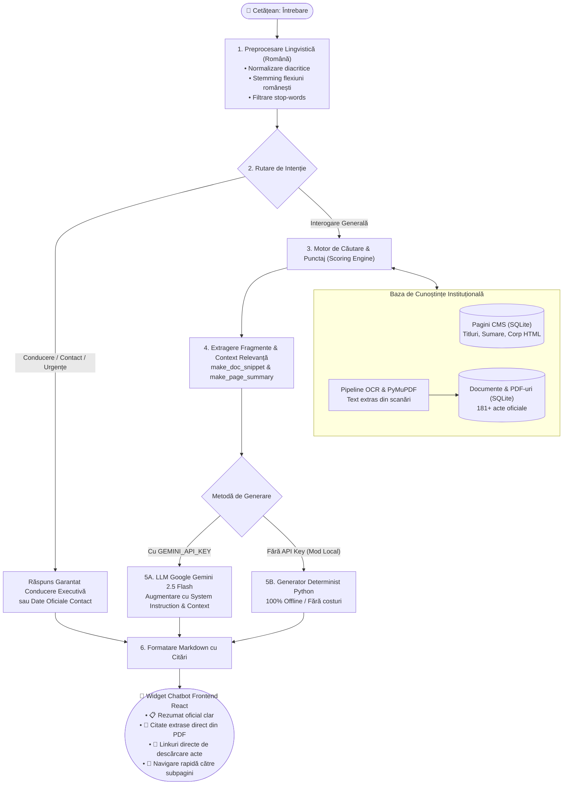

# Corcova website

Site React/Vite și API Django, cu baza SQLite și arhiva de documente incluse.
Pentru configurarea variabilelor de mediu și parole, creați fișierele `.env` pe baza șabloanelor `backend/.env.example` și `frontend/.env.example`.

## Conținut

- `frontend/`: surse React/Vite, componente administrative, căutare și prezentare modernă.
- `backend/`: aplicația Django, motor RAG & OCR, `db.sqlite3` și documentele din `media/`.
- `dosare/`, `uploads/`: arhiva media și documente publice.
- Dependențele instalate și fișierele `.env` cu parole nu sunt incluse în Git; se configurează local conform instrucțiunilor de mai jos.

## Instalare pe Linux

Necesită Python 3.12+ (Django 6), Node.js 22+ și suport pentru instalarea psycopg2 din requirements dacă nu există un wheel compatibil.

```sh
git clone https://github.com/2sto-dev/corcova-website.git
cd corcova-website/backend
python3 -m venv .venv
. .venv/bin/activate
pip install -r requirements.txt
```

În `backend/.env`, păstrează datele administratorului și configurează pentru server:

```dotenv
DJANGO_DEBUG=false
DJANGO_SECRET_KEY=<o valoare aleatoare nouă, generată pe server>
DJANGO_ALLOWED_HOSTS=comunacorcova.ro,www.comunacorcova.ro
CSRF_TRUSTED_ORIGINS=https://comunacorcova.ro,https://www.comunacorcova.ro
CORS_ALLOWED_ORIGINS=https://comunacorcova.ro,https://www.comunacorcova.ro
FRONTEND_URL=https://www.comunacorcova.ro/
DB_ENGINE=sqlite
```

Poți genera cheia cu `python -c "import secrets; print(secrets.token_urlsafe(64))"`.
Nu copia marcajul `<...>` ca valoare reală. Fișierele `.env` incluse conțin configurația locală, nu configurația finală de producție.

```sh
python manage.py check --deploy
python manage.py migrate
python manage.py collectstatic --noinput
gunicorn config.wsgi:application --bind 127.0.0.1:8000 --workers 2
```

Configurează Gunicorn ca serviciu persistent (de exemplu systemd). Pe Windows este necesar un server WSGI compatibil; Gunicorn rulează pe Linux.

Pentru frontend, într-un alt terminal:

```sh
cd frontend
npm ci
npm run build
```

Comanda pornește din rădăcina proiectului. Publică numai `frontend/dist` ca rădăcină statică în Nginx/Apache, cu HTTPS. Trimite către Django rutele `/api/`, `/gestionare-primarie/`, `/admin/` și `/administrare-primarie/`. Servește `/static/` din `backend/staticfiles/`. Documentele private sunt livrate prin API, nu printr-un alias public către `backend/media/`.

Nu publica rădăcina repository-ului, `.git`, `.env`, SQLite sau exportul SQL ca fișiere web. Contul serviciului Django trebuie să aibă drept de scriere asupra folderului bazei SQLite, inclusiv pentru jurnalele bazei.

## Administrare și date

Panou: `/gestionare-primarie/`. Datele de conectare sunt în `backend/.env`.
Contul există deja în SQLite; schimbarea `DJANGO_ADMIN_PASSWORD` în `.env` nu îi schimbă automat parola. Pentru resetare folosește `python manage.py changepassword NUME_UTILIZATOR`.

La actualizări, păstrează baza de producție, fișierele încărcate și configurația serverului: nu le suprascrie cu copia inițială din Git. Fă backup SQLite consistent și o copie a documentelor înainte de migrare. Păstrează backupurile separat, cu acces restricționat.

---

## Asistentul Virtual & Chatbot RAG (Arhitectură și Implementare)

Site-ul include un asistent virtual conceput pentru cetățeni, bazat pe **RAG (Retrieval-Augmented Generation)**. Sistemul răspunde la întrebări exclusiv pe baza **datelor oficiale din baza de date a primăriei și a textului extras din documentele PDF (inclusiv acte scanate)**, eliminând halucinațiile tipice modelelor generative.

### Schema Arhitecturală a Sistemului RAG



### Cum funcționează cele 4 etape ale pipeline-ului:

1. **Indexarea și Pipeline-ul OCR (`backend/documents/ocr_engine.py`):**
   - La încărcarea sau migrarea fișierelor oficiale, motorul extrage automat textul folosind **PyMuPDF (`fitz`)**.
   - Pentru actele scanate (fără strat vectorial de text), se aplică procesul **OCR** pentru a transforma imaginea în text căutabil.
   - Textul extras este salvat în câmpul `Document.extracted_text`, permițând căutarea în profunzime în peste **180 de documente** (hotărâri de consiliu, dispoziții, anunțuri de concurs, declarații).

2. **Procesarea Lingvistică a Întrebării (`backend/civic_core/chatbot.py`):**
   - **`normalize_ro(text)`**: elimină diacriticele (`ă`, `â`, `î`, `ș`, `ț`), asigurând că o căutare precum „primarie” sau „primărie” oferă aceleași rezultate.
   - **`get_stem(word)`**: algoritm adaptat flexiunilor din limba română (elimină terminațiile de genitiv, plural sau articulare: *-urilor*, *-iilor*, *-ului*, *-eaza*). Astfel, „ajutoarelor” și „ajutorul” conduc ambele la rădăcina `ajutor`.

3. **Regăsirea și Punctarea Relevanței (Retrieval & Scoring):**
   - **Rutare de intenție:** Întrebările despre conducerea primăriei identifică automat structura executivă reală (Adam DURAC – Primar, Gheorghe GOLOGAN – Viceprimar, etc.), eliminând orice deviere de context.
   - **Scoring Pagini:** Calculează relevanța pe baza potrivirii exacte sau parțiale în titlu, slug, sumar și corp.
   - **Scoring Documente PDF:** Punctează apariția termenilor în descriere și în textul scanat OCR. Funcția `make_doc_snippet()` decupează automat fraza din document care răspunde întrebării pentru a o include ca citat direct.

4. **Augmentarea și Generarea Răspunsului (Generation):**
   - **Modul Cloud (Gemini API):** Dacă în `.env` este prezent `GEMINI_API_KEY`, contextul extras din baza de date este trimis către `gemini-2.5-flash` cu un System Instruction instituțional. Modelul sintetizează un răspuns prietenos, dar ancorat strict în fapte.
   - **Modul Local (Fallback Determinist):** Dacă nu există conexiune sau cheie API externă, motorul Python generează direct răspunsul structurat pe 3 niveluri:
     - 📋 **Rezumat oficial**
     - 📂 **Documente și formulare conexe** (cu link direct de descărcare PDF)
     - 🔗 **Unde puteți citi mai multe** (linkuri către subpaginile site-ului)

